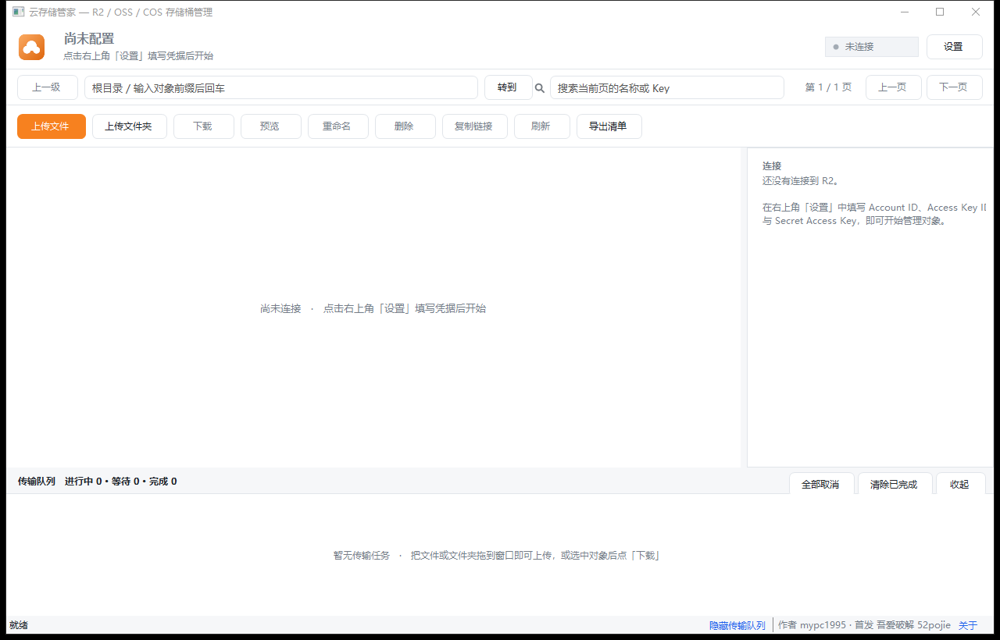
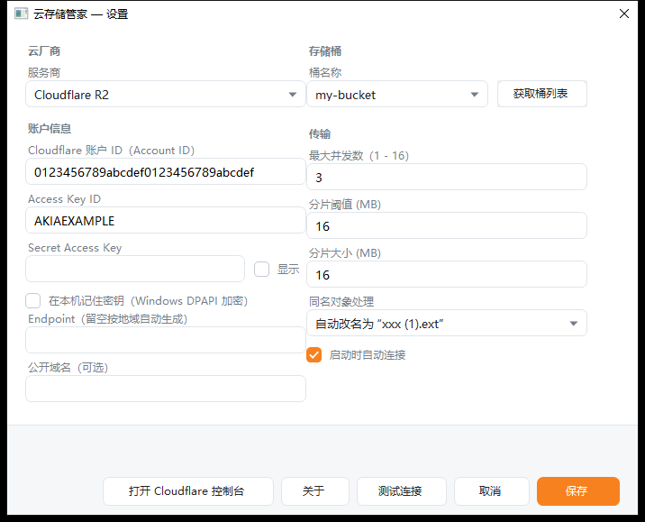
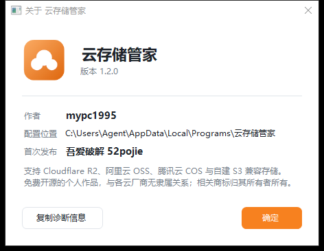

# 云存储管家 — R2 / OSS / COS 存储桶可视化管理工具

一个用 C# / .NET 10 + WinForms 写的桌面工具，面向“大文件”场景优化：分片上传、并行分片下载、实时进度、可取消、可重试。

支持三家公有云 + 自建存储：**Cloudflare R2**、**阿里云 OSS**、**腾讯云 COS**，以及任何兼容 S3 协议的自建服务（MinIO、Ceph RGW、SeaweedFS 等）。

> 作者：mypc1995 · 首次发布于吾爱破解 52pojie



<table>
<tr>
<td width="50%"></td>
<td width="50%"></td>
</tr>
<tr>
<td align="center"><sub>设置窗口：切换云厂商，字段随之增减</sub></td>
<td align="center"><sub>关于窗口：版本、作者与配置位置</sub></td>
</tr>
</table>

> 截图取自未配置凭据的初始状态，因此不含任何账号信息。

## 功能

| 分类 | 能力 |
| --- | --- |
| 查看 | 按前缀浏览目录（分页 1000 条/页）、列排序、客户端搜索、右侧对象详情、导出 CSV 清单 |
| 上传 | 单文件多选、整个文件夹递归上传、**拖拽文件/文件夹直接上传**；超过阈值自动走 S3 分片上传（并发上传分片），失败自动重试并中止残留分片 |
| 下载 | 单个「另存为」或批量按原目录结构下载；大文件自动拆成多个字节范围**并发拉取**，先写 `.r2tmp` 再原子替换，避免半截文件 |
| 预览 | 图片直接渲染、文本按 UTF-8 / GB18030 / GBK / Big5 / Shift-JIS 自动识别编码预览、二进制显示十六进制头部、内容/元信息双标签页、支持在多个选中对象间前后翻阅 |
| 删除 | 单个/批量删除、删目录（展开前缀下所有对象）、1000 个一批、可中途取消、逐个兜底重试并列出失败项 |
| 其它 | 对象重命名（服务端复制 + 删除，失败自动退回下载/上传方案）、复制 Key / 公开链接、传输队列（进度、速度、剩余时间、取消、清除、重试、打开所在文件夹） |

其它细节：

- 传输队列独立面板，每条任务显示进度条、实时速度与剩余时间，可单独取消。
- 密钥只在勾选「本机记住」时保存，使用 **Windows DPAPI（当前用户作用域）** 加密后写入配置文件。
- 配置与日志**默认放在程序所在目录**（用安装包装好后就是安装路径）：`settings.json` 与 `logs\`。整个目录可以整体拷走。若该目录不可写（例如装到 `C:\Program Files` 且以普通账户运行），自动退回 `%APPDATA%\R2Manager\`，实际路径在「关于」窗口和诊断信息里都能看到。
- 从旧版本升级时，程序第一次启动会自动把 `%APPDATA%\R2Manager\settings.json` **复制**一份到新目录，**密钥不用重新填**（DPAPI 熵固定不变，密文原样搬过去）。老目录里那份保留当备份。
- 单实例运行；窗口大小、分栏位置、传输面板可见性、最后浏览的目录都会记住。
- 异常会翻译成中文提示（如“签名不匹配”“桶不存在”“分片数据不完整”），并写入程序目录下的 `logs\`。
- 应用图标为 `src/R2Manager/app.ico`（多尺寸 16~256），通过 `<ApplicationIcon>` 写入 exe 资源，同时作为托管资源供运行时按尺寸取用；窗口的 `ICON_SMALL` / `ICON_BIG` 在 `OnLoad` 里按 `GetSystemMetrics` 各投一份原生尺寸，避免 Windows 缩放导致发糊。
- 界面内的 16×16 文件类型图标用 GDI+ 运行时绘制。
- 主窗口状态栏右侧常驻「作者 mypc1995 · 首发 吾爱破解 52pojie」与「关于」入口（设置窗口底部也有同一个入口）。作者与首发地统一放在 `Core/AppInfo.cs`，版本号从程序集 InformationalVersion 读取，另通过 `<Authors>` / `<Company>` / `<Copyright>` 写进 exe 文件属性。
- 「关于」窗口里有一个 **复制诊断信息** 按钮：一次性收集系统版本、临时目录可写性、单文件解压缓存、当前端点与网络连通性。遇到「双击没反应」这类问题时，把这段信息发给作者即可定位。

## 支持的存储

设置窗口顶部选「服务商」，下面的字段会跟着变。都走 S3 兼容接口，所以功能完全一致，差别只在接入参数：

| | Cloudflare R2 | 阿里云 OSS | 腾讯云 COS | 自建 / 私有 S3 |
| --- | --- | --- | --- | --- |
| Endpoint | 自动生成 `https://{AccountId}.r2.cloudflarestorage.com` | 自动生成 `https://s3.oss-{region}.aliyuncs.com` | 自动生成 `https://cos.{region}.myqcloud.com` | **手填**，如 `https://minio.example.com` |
| 要填的地域 | 固定 `auto` | `cn-hangzhou` 这类地域 ID | `ap-guangzhou` 这类地域 ID | 可留空，默认 `us-east-1` |
| 密钥字段 | Access Key ID / Secret Access Key | AccessKey ID / AccessKey Secret | SecretId / SecretKey | Access Key / Secret Key |
| 桶名 | 全局唯一 | 全局唯一，小写字母/数字/短横线，3~63 字符 | **必须带 APPID 后缀**，如 `mybucket-1250000000` | 自建那边的桶名 |
| 寻址方式 | 路径式（固定） | 虚拟主机式（固定） | 虚拟主机式（固定，2024-01-01 后新建的桶只支持这种） | **可选**，MinIO 默认路径式 |
| 公开域名 | 可填（如 r2.dev 或自绑域名） | 不需要 | 不需要 | 不需要 |

> 「公开域名」是 R2 特有的：它有现成的免配置公开地址（`*.r2.dev`）。阿里云 / 腾讯云 / 自建的公开链接由「桶名 + 端点」直接推导出来，所以界面上不显示这一项。

地域字段很宽容：填 `cn-hangzhou`、`oss-cn-hangzhou`，甚至直接粘控制台上的完整域名 `s3.oss-cn-hangzhou.aliyuncs.com`，程序都会自己归一化。

### Cloudflare R2

1. Cloudflare 控制台 → **R2 → Manage R2 API Tokens** → Create Account API Token（账号级，能列出所有桶）或 Create User API Token（只授权指定桶，更安全）。
2. 记下 **Access Key ID** 与 **Secret Access Key**，并复制页面上的 **Account ID**（32 位十六进制）。
3. 服务商选「Cloudflare R2」，填 Account ID / Access Key ID / Secret Access Key，桶名可直接手填或点「获取桶列表」。

### 阿里云 OSS

1. 阿里云控制台 → **RAM 访问控制 → AccessKey**，创建 AccessKey，并授予目标桶的 `oss:PutObject` / `oss:GetObject` / `oss:DeleteObject` / `oss:ListObjects` 权限。
2. 记下 **AccessKey ID** 与 **AccessKey Secret**。
3. 记下桶所在的**地域**（如 `cn-hangzhou`）。OSS **不支持跨地域访问**，端点和地域填错会直接报 `NoSuchBucket`。
4. 服务商选「阿里云 OSS」，填地域与两个密钥，桶名按 OSS 规则（小写、3~63 字符）。

### 腾讯云 COS

1. 腾讯云控制台 → **访问管理 → API 密钥管理**，记下 **SecretId**、**SecretKey**，以及账号的 **APPID**。
2. 记下桶所在的**地域**（如 `ap-guangzhou`）。
3. 服务商选「腾讯云 COS」，填地域与两个密钥。桶名必须带 APPID 后缀（控制台创建时会自动带上，直接复制即可）。

### 自建 / 私有 S3 兼容存储

MinIO、Ceph RGW、SeaweedFS、Garage 等只要兼容 S3 协议就能用：

1. 服务商选「自建 / 私有 S3 兼容存储」。
2. **Endpoint 必填**，写服务地址，例如 `https://minio.example.com`、`http://192.168.1.10:9000`。
   - 没配 TLS 的自建服务用 `http://` 开头即可。
3. 填 **Access Key** / **Secret Key**。
4. **地域**：大多数自建服务不校验，留空即可（默认按 `us-east-1` 签名）。
5. **寻址方式**：MinIO 默认选「路径式」（`minio.example.com/bucket/key`）；如果你的服务配了虚拟主机式域名，就选「虚拟主机式」（`bucket.minio.example.com/key`）。不确定就先用路径式，报 404 再换。
6. 桶名填自建那边的桶名。

> 「获取桶列表」需要账号级权限。密钥只有对象级权限时会返回 403——**不影响任何实际功能**，直接在桶名框里手动填就行。

## 快速开始

### 1. 编译与运行

需要 [.NET 10 SDK](https://dotnet.microsoft.com/download)（本机已装 10.0.402）。

```powershell
# 调试运行
dotnet run --project src\R2Manager\R2Manager.csproj

# 编译
dotnet build src\R2Manager\R2Manager.csproj -c Release

# 一键编译 + 发布（见下）
.\build.ps1
```

### 2. 发布成单个 exe

```powershell
# 免安装自包含（约 106 MB，目标机无需装 .NET）
dotnet publish src\R2Manager\R2Manager.csproj -c Release -r win-x64 --self-contained true `
  -p:PublishSingleFile=true -p:IncludeNativeLibrariesForSelfExtract=true -o dist

# 依赖运行时版（约 2 MB，目标机需装 .NET 10 Desktop Runtime）
dotnet publish src\R2Manager\R2Manager.csproj -c Release -r win-x64 --self-contained false `
  -p:PublishSingleFile=true -o dist-fd
```

产物名为 `云存储管家.exe`。

### 3. 打包成安装程序

```powershell
.\build.ps1 -Installer
```

用 [Inno Setup 6](https://jrsoftware.org/isdl.php) 编译，产物是 `dist\云存储管家-安装程序.exe`（约 34 MB，lzma2 压缩）。

安装程序的特点：

- **中文向导**，安装路径可以自己选；默认落在 `%LOCALAPPDATA%\Programs\云存储管家`（免管理员权限，且该目录一定可写，配置就能放在安装目录里）。
- 开始菜单快捷方式 + 可选的桌面快捷方式 + 标准的「应用和功能」卸载项。
- 装到 `C:\Program Files` 这类受保护位置时，程序会自动把配置改存到用户目录，不会写不进去。
- 卸载**不删** `settings.json`（里面是用户已保存的密钥），需要彻底清除就手动删安装目录。

安装脚本在 `installer/云存储管家.iss`，中文语言文件在 `installer/ChineseSimplified.isl`（社区翻译，Inno 6.5+ 可用）。

### 4. 首次使用

启动后点右上角 **设置**：先选「服务商」，再按上面的表格填对应字段。

- 「获取桶列表」会自动列出该凭据可访问的桶；
- 「测试连接」验证凭据是否有效；
- 需要的话设置**公开域名**，之后「复制链接」就直接生成公开 URL。

填好保存即可开始使用。

## 「双击没反应」怎么办

免安装单文件 exe 在**首次运行**时要把 .NET 运行时解压到临时目录（实测约 266 MB / 170 个文件），这段时间窗口还没出现，看着像没反应。正常机器 3~5 秒，杀软逐个扫描时可能到几十秒。**第二次启动会快得多**（解压结果会缓存）。

如果一直没有任何反应，按这个顺序排查：

1. **杀毒软件拦截**。国产杀软常直接隔离未签名程序。把 exe 加入白名单，或右键「还原」被隔离的文件。
2. **文件不完整**。重新下载，用随包附带的 `SHA256.txt` 核对。
3. **Windows 提示「已保护你的电脑」**（SmartScreen）。点「更多信息」→「仍要运行」。
4. **临时目录不可写**。程序会在临时目录解压运行时；被组策略限制或磁盘满时会失败。
5. **确认到底卡在哪**。打开 **关于 → 复制诊断信息**，把内容发过来，里面有系统版本、临时目录可写性、解压缓存状态和端点连通性。

程序本身也做了兜底：启动阶段的任何异常都会弹窗并写日志，不会再无声无息地退出。日志在程序目录下的 `logs\r2manager-YYYYMMDD.log`（安装版即安装目录里）。

## 快捷键

| 按键 | 功能 |
| --- | --- |
| `Ctrl+U` | 上传文件 |
| `Ctrl+F` | 定位搜索框 |
| `Ctrl+R` / `F5` | 刷新当前目录 |
| `Ctrl+L` | 复制链接 |
| `Delete` | 删除选中项 |
| `Enter` | 打开目录 / 预览文件 |
| `Backspace` | 返回上级目录 |
| `Esc` | 清空搜索 |
| `←` / `→` | 预览窗口内切换上一个 / 下一个对象 |

## 传输参数怎么调

在 **设置 → 传输** 中：

- **最大并发数**：同时进行的传输任务数（同时也是单个大文件内部的分片并发数）。默认 3；网络稳定、带宽富余可调到 6~8，注意各家的请求频率限制。
- **分片阈值 (MB)**：小于该值的文件走单次 PUT，大于则走分片上传。默认 16 MB。
- **分片大小 (MB)**：分片上传/下载的分块粒度。默认 16 MB；100 GB 以上的大文件可调到 64~128 MB 以减少请求数。
- **同名对象处理**：覆盖 / 跳过 / 自动改名（`xxx (1).ext`），可在「设置」里随时改。

## 项目结构

```
R2UP/
├─ build.ps1                     一键编译 / 发布（-Installer 顺带出安装包）
├─ docs/screenshot.png           主界面截图
├─ docs/screenshot-settings.png  设置窗口截图
├─ docs/screenshot-about.png     关于窗口截图
├─ docs/发布介绍.md
├─ docs/使用说明.txt             随发布包附带的上手说明
├─ installer/
│  ├─ 云存储管家.iss             Inno Setup 安装脚本（中文向导、可选安装路径）
│  └─ ChineseSimplified.isl     中文语言文件（社区翻译）
├─ tools/
│  ├─ uiprobe/                   UI 探针：直接打开设置/关于窗口，用于核对排版
│  │                              （含 selftest 界面自检与 layout 布局体检）
│  ├─ s3probe/                   S3 请求形状探针：拦截 SDK 原始请求，核对寻址/签名/分块编码
│  ├─ logo/                      Logo 生成器：矢量栅格绘制 + 多尺寸 ico
│  ├─ pack-7z.py                 发布包打包脚本
│  └─ rename-cloudstore.ps1      一次性命名空间改名脚本（历史留档）
└─ src/R2Manager/
   ├─ R2Manager.csproj
   ├─ app.ico                     应用图标（ApplicationIcon + 运行时按尺寸取用）
   ├─ Program.cs                  入口：单实例、DPI、编码提供程序、全局异常兜底
   ├─ Core/
   │  ├─ StorageService.cs        S3 端点封装（列举/元信息/下载/删除/复制/桶列表）
   │  ├─ StorageProvider.cs       三家云的差异表（端点/寻址/地域/字段名/桶名规则/公开链接）
   │  ├─ MultipartUploader.cs    分片上传（并发、重试、中止）
   │  ├─ ParallelDownloader.cs   并行范围下载（临时文件 + 原子替换）
   │  ├─ TransferManager.cs      传输队列与并发调度
   │  ├─ TransferQueue.cs        把上传/下载包装成队列任务
   │  ├─ PreviewLoader.cs        图片/文本/二进制预览与元信息
   │  ├─ StorageSettings.cs       配置模型与校验
   │  ├─ SettingsStore.cs        配置持久化（含旧目录迁移）
   │  ├─ AppPaths.cs             配置/日志目录解析（程序目录优先，不可写时退回用户目录）
   │  ├─ SecretProtector.cs      DPAPI 密钥保护
   │  ├─ FolderScanner.cs        本地目录递归扫描
   │  ├─ Humanize.cs             体积/速度/编码/MIME/安全文件名
   │  ├─ ProgressStream.cs       上传进度流包装
   │  ├─ Diagnostics.cs          环境自检（临时目录/解压缓存/配置目录/端点连通性）
   │  ├─ AppInfo.cs               作者 / 首发地 + 从程序集读取的版本号
   │  └─ ErrorInfo.cs            异常中文化与日志
   └─ UI/
      ├─ MainForm.cs             主窗口
      ├─ TransferPanel.cs        传输队列面板
      ├─ PreviewForm.cs          预览窗口
      ├─ SettingsForm.cs         设置窗口（双栏、无滚动）+ 重命名对话框
      ├─ AboutForm.cs            关于窗口（版本 / 作者 / 首发信息 / 配置位置 / 诊断信息）
      ├─ FlatButton.cs           自绘圆角按钮（Normal / Primary / Danger / Ghost）
      ├─ FlatControls.cs         圆角输入框、勾选框、下拉框
      ├─ UiEx.cs                 配色、控件工厂、状态指示器、应用图标取用
      └─ UiIcons.cs              运行时绘制的 16×16 文件类型图标
```

## 实现要点

- **统一走 S3 兼容协议**：三家公有云 + 自建存储都提供 S3 接口，所以传输、分片、预览、删除这些逻辑只有一份。差异全部收敛在 `Core/StorageProvider.cs` 一张表里：端点怎么拼、用哪种寻址方式、签名用哪个地域、凭据字段叫什么、桶名和公开链接各有什么规矩。
- **寻址方式按厂商切换**：R2 用 path-style（桶名在路径里）；OSS 与 COS 用 virtual-hosted（桶名在主机名里）；自建存储由用户选（MinIO 默认 path-style）。腾讯云 2024 年 1 月 1 日后新建的存储桶彻底不支持 path-style，这一条踩不得。
- **签名地域**：R2 固定 `auto`；OSS 用地域 ID（`cn-hangzhou`）；COS 用地域 ID（`ap-guangzhou`）；自建默认 `us-east-1`。
- **分片上传**：单文件分片数上限 10000，超过时自动放大分片尺寸；每片独立重试 3 次；任一环节失败都会 `AbortMultipartUpload`，避免残留分片计费。
- **并行下载**：按 `并发数 × 4` 计算块大小（4~64 MB），多路 `Range` 请求分别 seek 写入同一个文件；每块重试 3 次；成功后才 `File.Move` 覆盖目标。
- **内存控制**：分片上传用 `ArrayPool<byte>` 按并发数分配缓冲，不会把整个文件读进内存。
- **对象 key 安全**：下载落盘时逐段清洗路径（非法字符、`.` / `..`、Windows 保留名、超长名），杜绝路径穿越。
- **SDK**：`AWSSDK.S3 3.7.511.8`（新版自定义模型 API）。

### ⚠️ 接 R2 / OSS 必须的两个 SDK 设置（别删）

R2 和阿里云 OSS **都不实现 aws-chunked 流式签名**，AWS SDK 默认就会用它，所以下面两处缺一不可：

1. **`PutObjectRequest.DisablePayloadSigning = true`**（`MultipartUploader` 里单次 PUT 和 `UploadPartRequest` 各一处）
   否则请求头是 `x-amz-content-sha256: STREAMING-AWS4-HMAC-SHA256-PAYLOAD`，服务端直接返回
   `501 STREAMING-AWS4-HMAC-SHA256-PAYLOAD not implemented`，**所有上传全挂**。
   注意这是**逐请求**属性，`AmazonS3Config` 上没有对应开关，只能设在请求对象上。
2. **`AmazonS3Config.RequestChecksumCalculation / ResponseChecksumValidation = WHEN_REQUIRED`**
   否则 SDK 3.7.5xx 会追加柔性校验和尾部，报 `STREAMING-...-PAYLOAD-TRAILER not implemented`；
   只关载荷签名仍会变成 `STREAMING-UNSIGNED-PAYLOAD-TRAILER`，一样被拒。**两个必须一起设。**

另外 `ProgressStream` 必须保持可定位（`CanSeek/Seek/Position` 全部透传）：SDK 靠它判断能否预读计算哈希，
报 `CanSeek=false` 会让签名行为不可预期。

这几种接入的请求形状都可以离线核对（不联网、不需要真实账号）：

```powershell
# 请求形状：寻址方式、签名地域、有没有误用 aws-chunked
dotnet run --project tools\s3probe\s3probe.csproj -c Release

# 界面自检：下拉切厂商后字段显隐、保存值、公开链接构造
dotnet run --project tools\uiprobe\uiprobe.csproj -c Release -- selftest
```

## 已知限制

- 需要对象级权限的 API（改名用的 `CopyObject`）在只读密钥下不可用，此时会自动退回「下载 + 上传 + 删除」方案，大文件会较慢。
- 预览不支持 HEIC/AVIF 等系统未注册解码器的格式，也不渲染 SVG；这类文件会提示改用下载或系统程序打开。
- 分页按 1000 条/页读取，搜索只作用于当前页。
- 单文件上传进度基于已读取字节，服务端最终确认会有几秒延迟。
- 「获取桶列表」调用的是 S3 的 `ListBuckets`，**需要账号级权限**。只有对象级权限的密钥会返回 403；此时桶名可以直接手动输入，不影响上传下载。
- 阿里云 OSS 的分片 ETag 计算方式与 S3 不同，跨云校验时不能直接比对 ETag。
